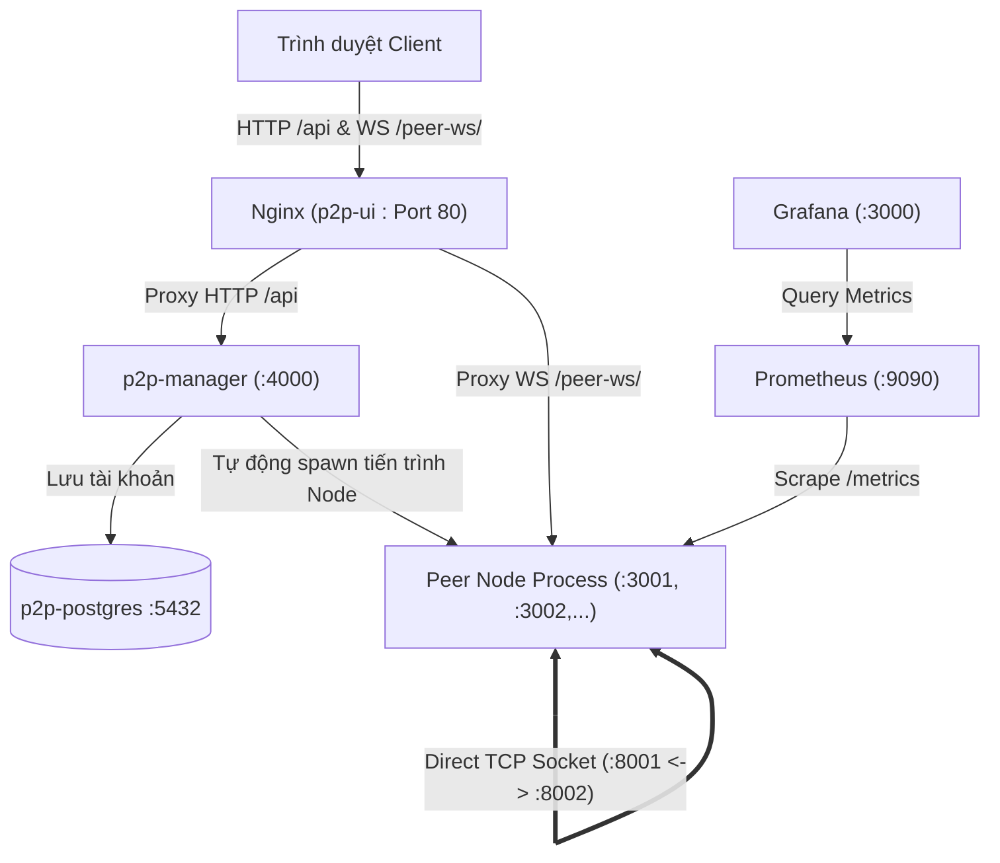

# Thiết kế và Hiện thực Mạng Phân tán P2P Dựa trên Kademlia DHT và Định tuyến Mesh Relay Kết hợp Bảo mật E2EE Phi Tập Trung (Zero SPOF)
## Đề tài môn học: Các hệ thống phân tán (Distributed Systems)

Dự án nghiên cứu, thiết kế và triển khai kiến trúc mạng phân tán Peer-to-Peer (P2P) kết hợp bảng băm phân tán Kademlia DHT (Zero SPOF), cơ chế định tuyến đa chặng Mesh Relay, giải pháp bảo mật mã hóa đầu cuối E2EE phi tập trung, đồng hồ logic Lamport & Vector Clocks, hệ thống điều phối Node theo yêu cầu (Dynamic On-Demand Peer Spawner), xác thực JWT có kiểm soát Brute-force và tầng giám sát thời gian thực với Prometheus & Grafana.

---

## 📌 PHẠM VI & TÍNH NĂNG NỔI BẬT

### 1. Kiến trúc Phi tập trung hoàn toàn (Pure P2P DHT - Zero SPOF)
- **Kademlia DHT**: Các peer tự khám phá lẫn nhau mà không cần bất kỳ máy chủ Registry tập trung nào.
- Không gian định danh 160-bit SHA-1, khoảng cách logic metric XOR \(d(x, y) = x \oplus y\), 160 K-Buckets kết hợp thuật toán trục xuất LRU.
- **Node ID mật mã học**: $\text{Node ID} = \text{SHA1}(\text{PublicKey})$ (sinh từ cặp khóa Ed25519) chống xung đột tên (Anti Name-Collision) và ngăn chặn mạo danh ID.
- **Hàn gắn phân mảnh mạng (Network Partition Healing)**: Tự động dò quét và tái kết nối bootstrap khi mạng bị chia cắt rồi phục hồi.
- Các hàm RPC giao thức: `DHT_PING`, `DHT_PONG`, `DHT_FIND_NODE`, `DHT_FIND_NODE_RESP`, `DHT_STORE`, `DHT_FIND_VALUE`.

### 2. Điều phối Peer Node theo yêu cầu (On-Demand Dynamic Spawner)
- **Không có node ảo chạy sẵn**: Khi Docker khởi động, số lượng peer ban đầu là **0**.
- **Tự động sinh Node khi đăng ký**: Khi người dùng đăng ký tài khoản mới trên giao diện Web, `p2p-manager` tự động cấp phát cổng độc quyền (UI port $3000+N$, TCP port $8000+N$) và kích hoạt một tiến trình Node riêng biệt chạy ngầm.
- **Cô lập dữ liệu tuyệt đối (Multi-Tenancy)**: Dữ liệu tin nhắn, danh bạ peer được phân định nghiêm ngặt theo `node_owner` trong PostgreSQL. Mỗi tài khoản chỉ xem được dữ liệu của chính mình.

### 3. Đồng hồ Logic (Leslie Lamport 1978) & Vector Clocks
- Khắc phục triệt để hiện tượng lệch đồng hồ vật lý (Clock Skew / NTP Drift).
- Gắn nhãn `lamport_clock` và `vector_clock` lên từng gói tin để đảm bảo trật tự quan hệ nhân quả (Causality & Happens-Before).
- Tin nhắn luôn được hiển thị đúng trình tự thời gian logic trên giao diện.

### 4. Định tuyến 2 lớp: Direct TCP Socket & Mesh Relay Đa chặng
- **Ưu tiên 1 - Direct Socket**: Mở kết nối TCP 1-chặng gửi trực tiếp giữa hai peer thông qua địa chỉ tra cứu từ DHT.
- **Ưu tiên 2 - Mesh Relay**: Nếu đường truyền trực tiếp bị chặn firewall hoặc lỗi NAT, hệ thống tự động mượn một peer trung gian thứ 3 để chuyển tiếp gói tin (mang nhãn `RELAY_FORWARD`, có TTL chống lặp vòng).

### 5. Hộp thư ngoại tuyến phân tán (Distributed Mailbox trên DHT)
- Nếu người nhận đang Offline, gói tin được đưa vào Distributed Mailbox lưu trữ tạm thời trên 3 node DHT gần nhất.
- Khi người nhận online trở lại, node tự động truy vấn `DHT_FIND_VALUE` để tải toàn bộ tin nhắn chưa đọc về máy.

### 6. Truyền tập tin phân đoạn (Chunked File Transfer 64KB)
- Chia nhỏ tập tin thành các mảnh 64KB, gửi tuần tự và xác nhận bằng `FILE_ACK`.
- Kiểm tra toàn vẹn tập tin sau khi ráp nối bằng mã băm SHA-256.

### 7. Tầng giám sát thời gian thực (Prometheus & Grafana)
- Endpoint `/metrics` chuẩn Prometheus trên từng Peer Node.
- Dashboard Grafana trực quan hóa số lượng Peer Online thời gian thực (`p2p_active_peers_count`), tổng số gói tin, dung lượng truyền nhận và tài nguyên CPU/RAM container.

---

## 🏛️ KIẾN TRÚC HỆ THỐNG & CỔNG DỊCH VỤ



| Dịch vụ Container | Cổng Host | Giao thức | Chức năng |
| :--- | :--- | :--- | :--- |
| **`p2p-ui`** | `80` (và `5173`) | HTTP / WS | Nginx phục vụ React SPA & Reverse Proxy duy nhất |
| **`p2p-manager`** | Nội bộ (`:4000`) | HTTP / TCP | Gateway xác thực, cấp JWT & Tự động spawn Peer Node |
| **`p2p-postgres`** | `5432` | TCP | Cơ sở dữ liệu PostgreSQL lưu trữ Users, Messages, DHT |
| **`p2p-grafana`** | `3000` | HTTP | Bảng điều khiển giám sát hệ thống (admin / admin) |
| **`p2p-prometheus`** | `9090` | HTTP | Thu thập số liệu giám sát từ các Peer Node |
| **`p2p-cadvisor`** | `8088` | HTTP | Giám sát tài nguyên Docker Container |
| **`p2p-node-exporter`**| `9100` | HTTP | Giám sát tài nguyên máy chủ host |

---

## 🚀 HƯỚNG DẪN KHỞI ĐỘNG HỆ THỐNG TỪ ĐẦU (CLEAN START)

### Bước 1: Kéo mã nguồn mới nhất & Cấu hình biến môi trường (`.env`)
```bash
cd ~/secure-p2p-network
git pull origin main

# Tạo file .env từ file mẫu nếu chưa có (chỉnh sửa mật khẩu nếu cần)
cp -n .env.example .env
```

### Bước 2: Dọn sạch toàn bộ dữ liệu & container cũ
Lệnh này sẽ xóa sạch các container cũ, mạng ảo và volume cơ sở dữ liệu `postgres_data` để làm lại từ đầu:
```bash
sudo docker compose down -v
```

*(Tùy chọn: Nếu bạn muốn dọn sạch bảng CSDL trong pgAdmin mà không xóa container, chạy lệnh SQL sau)*:
```sql
TRUNCATE TABLE messages, conversations, files, peers, dht_storage, node_identity, node_state, users CASCADE;
```

### Bước 3: Build và khởi động lại toàn bộ hệ thống
```bash
sudo docker compose up -d --build
```

### Bước 4: Kiểm tra trạng thái hệ thống
Xem các container đang chạy:
```bash
sudo docker compose ps
```
*Kết quả phải thấy 7 container đều ở trạng thái `running` (Up), **không có bất kỳ peer-1, peer-2 tĩnh nào**.*

Kiểm tra log của Manager:
```bash
sudo docker compose logs -f manager
```
*Khi thấy dòng sau là hệ thống đã sẵn sàng*:
```
✅ Đã đồng bộ Schema Database PostgreSQL thành công.
🚀 Central Auth Gateway & Node Manager đang lắng nghe tại HTTP port: 4000
🚀 Discovery Registry Server đang lắng nghe tại TCP port: 7000
Chưa có tài khoản nào trong hệ thống. Đang chờ người dùng đăng ký...
```

---

## 💬 HƯỚNG DẪN TRẢI NGHIỆM TÍNH NĂNG

### 1. Đăng ký & Chat P2P thời gian thực
1. **Mở trình duyệt 1**: Truy cập `http://localhost` (hoặc domain Cloudflare tunnel).
2. Nhấp tab **Đăng ký tài khoản**:
   - Tên đăng nhập: `minh`
   - Tên hiển thị: `Minh`
   - Mật khẩu: `Minh@123456` (phải có chữ hoa, thường, số, ký tự đặc biệt).
   - Nhấn **Đăng ký** $\rightarrow$ Hệ thống tự động tạo Node 1 cho Minh (cổng UI 3001, TCP 8001).
3. **Mở trình duyệt 2** (hoặc Cửa sổ ẩn danh / thiết bị khác):
   - Đăng ký tài khoản thứ hai: `phu` / `Phu@123456`.
   - Hệ thống tự động tạo Node 2 cho Phú (cổng UI 3002, TCP 8002) và tự bootstrap vào Node 1.
4. **Nhắn tin trực tiếp**:
   - Ở cả 2 màn hình, bạn sẽ thấy đối phương sáng đèn **Online (Chấm xanh)**.
   - Bấm vào tên đối phương và gửi tin nhắn $\rightarrow$ Tin nhắn được truyền trực tiếp qua Socket TCP 1-chặng với độ trễ cực thấp.

### 2. Thử nghiệm Định tuyến Đa chặng Mesh Relay
1. Đăng ký tài khoản thứ ba: `nam`.
2. Trên màn hình của `minh`, mở Panel **Protocol Logs** ở cột bên phải, bấm nút **Mô phỏng Chặn Firewall tới Phú**.
3. Gửi tin nhắn từ `minh` tới `phu` $\rightarrow$ Quan sát log sẽ thấy hệ thống tự động chuyển tiếp qua `nam`:
   $$\text{Minh} \xrightarrow{\text{Chặng 1}} \text{Nam} \xrightarrow{\text{Chặng 2}} \text{Phú}$$

### 3. Thử nghiệm Hộp thư ngoại tuyến (Distributed Mailbox)
1. Tắt tab trình duyệt của `phu`.
2. `minh` gửi một tin nhắn cho `phu` $\rightarrow$ Log hiển thị tin nhắn được cất vào **Distributed Mailbox trên DHT**.
3. Mở lại tab và đăng nhập tài khoản `phu` $\rightarrow$ Node tự động rút tin nhắn offline về và hiển thị lên khung chat!

### 4. Xem Dashboard Giám sát Grafana
- Truy cập: `http://localhost:3000` (hoặc `http://<IP_Server>:3000`).
- Đăng nhập: Tài khoản `admin` / Mật khẩu `admin`.
- Mở Dashboard: **P2P Network Overview**:
  - **Active Peers Count**: Hiển thị chính xác số Node P2P đang trực tuyến (khởi điểm từ 0 và tăng dần khi có người đăng ký).
  - **Messages Sent/Received**: Biểu đồ số lượng tin nhắn trao đổi.
  - **System Metrics**: Biểu đồ CPU, RAM, Event Loop của các container.

---

## 🧪 BỘ KIỂM THỬ TỰ ĐỘNG (AUTOMATED TEST SUITES)

Dự án cung cấp bộ kịch bản kiểm thử toàn diện các thuật toán phân tán:

```bash
# 1. Kiểm thử Thuật toán Kademlia DHT (XOR metric, K-buckets, LRU Eviction):
npm run test:dht:unit

# 2. Kiểm thử Tính nhân quả & Đồng hồ Logic (Lamport Logical Clocks & Vector Clocks):
npm run test:causality

# 3. Kiểm thử Định tuyến đa chặng Mesh Relay (Multi-hop Overlay, TTL, Loop Prevention):
npm run test:mesh

# 4. Kiểm thử Bền vững dữ liệu DHT & Distributed Mailbox offline:
npm run test:persistence

# 5. Kiểm thử Xung đột định danh & Tự động hàn gắn phân mảnh mạng (Network Partition Healing):
npm run test:healing

# 6. Kiểm thử Bộ ba tính năng Bảo mật (JWT + Chống Brute-force + Chính sách mật khẩu):
npm run test:security
```
