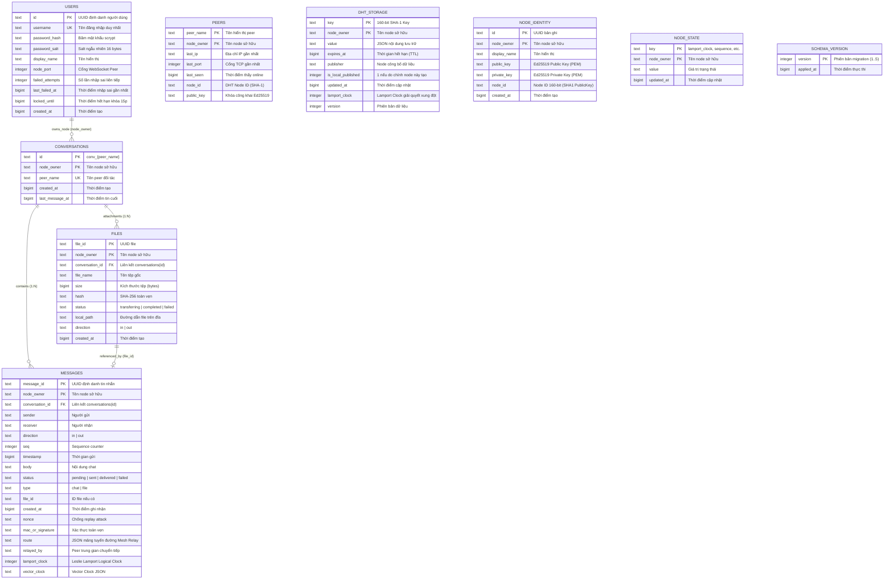

# Sơ đồ Cơ sở Dữ liệu & ERD Backend (PostgreSQL)

Hệ thống lưu trữ backend được thiết kế theo mô hình **Multi-Tenant** thông qua cột `node_owner`, cho phép nhiều peer node cùng chia sẻ một cụm cơ sở dữ liệu PostgreSQL duy nhất mà vẫn đảm bảo phân tách dữ liệu an toàn.

---

## 1. Vị trí các file liên quan tới Database

- **File kết nối chính**: [peer/db/connection.ts](file:///D:/P2P/secure-p2p-network/peer/db/connection.ts)
  - Khởi tạo và quản lý `pg.Pool` (`createDatabasePool`)
  - Hàm kiểm tra kết nối (`testDatabaseConnection`)
- **File Data Access Layer**: [peer/db/message-store.ts](file:///D:/P2P/secure-p2p-network/peer/db/message-store.ts)
  - Đóng gói toàn bộ các thao tác nghiệp vụ CRUD (Lưu tin nhắn, hàng đợi offline, phân trang lịch sử, xử lý DHT KV store)
- **File Quản lý Xác thực & Tài khoản**: [peer/db/user-service.ts](file:///D:/P2P/secure-p2p-network/peer/db/user-service.ts)
  - Đăng ký, đăng nhập, băm mật khẩu bảo mật (scrypt + salt), thẩm định chính sách mật khẩu mạnh, chống tấn công Brute-force
- **File Cấp phát & Xác thực JWT**: [peer/db/jwt-service.ts](file:///D:/P2P/secure-p2p-network/peer/db/jwt-service.ts)
  - Ký và xác minh JWT Token bằng thuật toán `HMAC-SHA256` chống can thiệp trái phép
- **File Khởi tạo Schema & Migrations**: [peer/db/migrations.ts](file:///D:/P2P/secure-p2p-network/peer/db/migrations.ts)
  - Tự động tạo bảng và nâng cấp schema từ V1 đến V7 (Bao gồm bảng `users` và các trường khóa bảo vệ)
- **File Cấu hình kết nối**: [common/config.ts](file:///D:/P2P/secure-p2p-network/common/config.ts) & [config.json](file:///D:/P2P/secure-p2p-network/config.json)
  - Đọc thiết lập kết nối (`host`, `port`, `database`, `user`, `password`, `max pool`) và hỗ trợ override qua biến môi trường (`DB_HOST`, `DB_PORT`, `DB_NAME`, v.v.).

---

## 2. Sơ đồ Thực thể - Mối quan hệ (ERD)

---

## 3. Mô tả chi tiết các bảng

| Bảng | Mục đích | Khóa chính (Composite PK) |
|---|---|---|
| **`conversations`** | Quản lý phiên hội thoại giữa node hiện tại và từng peer đối tác | `(id, node_owner)` |
| **`messages`** | Lưu trữ toàn bộ tin nhắn chat, trạng thái (pending/sent/delivered), dấu thời gian vật lý & đồng hồ logic Lamport/Vector Clock, tuyến định tuyến đa chặng Mesh Relay | `(message_id, node_owner)` |
| **`files`** | Quản lý thông tin truyền nhận tệp (hash SHA-256, kích thước, tiến độ, đường dẫn lưu trữ local) | `(file_id, node_owner)` |
| **`peers`** | Danh bạ các peer đã từng liên lạc (IP, TCP Port, Ed25519 Public Key, Node ID) | `(peer_name, node_owner)` |
| **`dht_storage`** | Bảng Key-Value phân tán Kademlia (lưu trữ phân tán, Mailbox tin nhắn offline, phục vụ Self-Healing) | `(key, node_owner)` |
| **`node_identity`** | Cặp khóa mật mã học Ed25519 và Node ID cố định của từng peer | `(id, node_owner)` |
| **`node_state`** | Trạng thái đồng hồ Lamport Clock nhằm đảm bảo tính đơn điệu (Monotonicity) qua các lần khởi động | `(key, node_owner)` |
| **`schema_version`** | Theo dõi lịch sử migration phiên bản CSDL | `version` |
