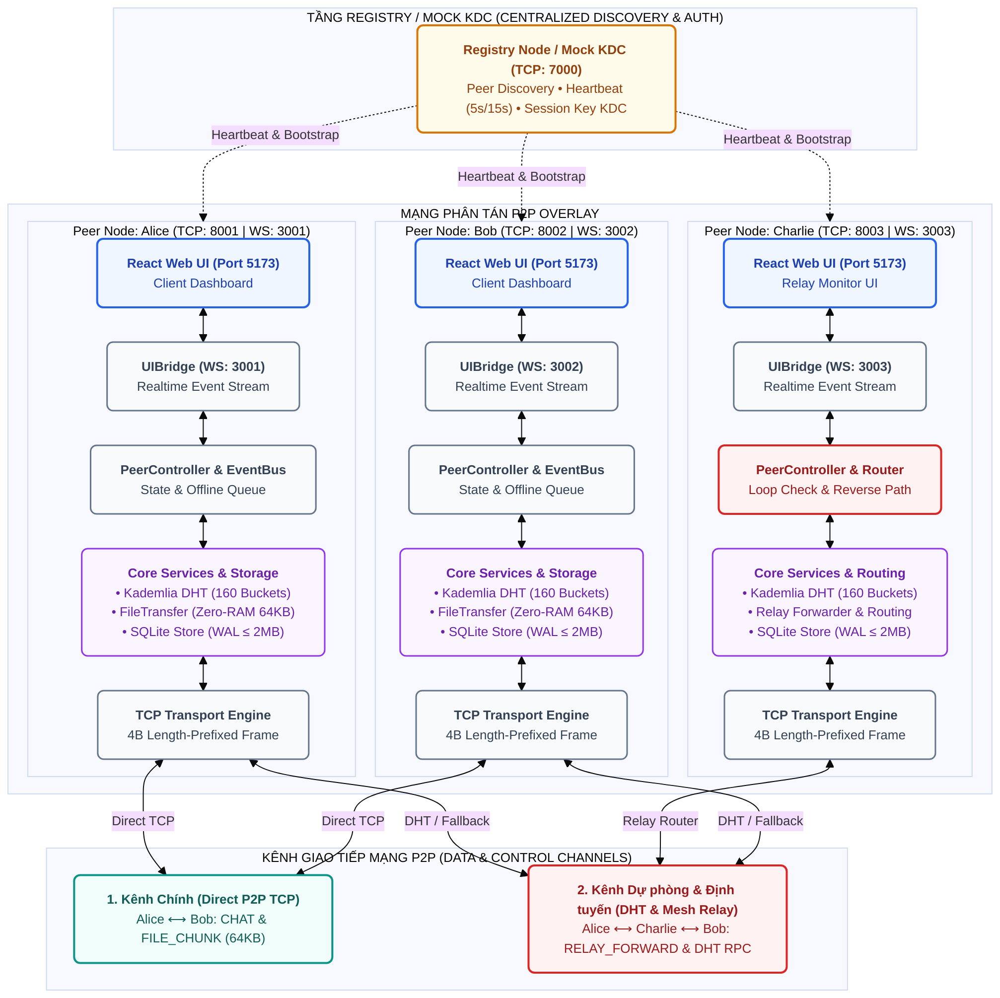

# KẾ HOẠCH TRIỂN KHAI: THIẾT KẾ VÀ HIỆN THỰC MẠNG PHÂN TÁN P2P DỰA TRÊN KADEMLIA DHT VÀ ĐỊNH TUYẾN MESH RELAY KẾT HỢP BẢO MẬT KDC
### Ứng dụng thực nghiệm: Chat thời gian thực & Truyền tập tin P2P (Distributed Core + React UI)

---

## 1. GIẢ ĐỊNH & THIẾT KẾ CƠ BẢN

1. **Môi trường & Ngôn ngữ**:
   - Backend sử dụng **Node.js (TypeScript, ESM)** cho cả Registry và Peer Backend để dùng chung Type Definitions (`common/protocol.ts`) giữa Backend và Frontend, giảm thiểu lỗi format message.
   - Frontend sử dụng **React + Vite + Tailwind CSS + TypeScript**.
   - Cơ sở dữ liệu: **SQLite** thông qua thư viện native `better-sqlite3` (nhẹ, nhanh, đồng bộ, hoàn hảo cho node P2P cục bộ).
2. **Cơ chế truyền nhận qua TCP Socket thô (Framing)**:
   - Dùng **Length-prefixed framing** (4 bytes `Int32BE` quy định độ dài payload + JSON UTF-8 payload). Cơ chế này tối ưu cho việc truyền file chunk và tin nhắn dài, tránh rủi ro vỡ/dính gói tin TCP stream.
3. **Mô hình định danh Peer & Mạng**:
   - Một Peer định danh duy nhất bởi `displayName` (chuỗi ký tự). Khi chạy trên cùng máy, mỗi peer bind một cổng TCP riêng (ví dụ 8001, 8002...) và một cổng WebSocket riêng cho UI (ví dụ 3001, 3002...).
   - Registry chạy trên cổng cố định (mặc định TCP `7000`, có thể cấu hình qua `.env` / config).
4. **Trách nhiệm bảo mật**:
   - Giai đoạn 1 toàn bộ gói tin truyền dạng **Plaintext** (để dễ dàng inspect Wireshark minh chứng trước/sau khi áp dụng KDC & crypto ở Giai đoạn 2).
   - Thiết kế cắm sẵn interface `Channel` và `MessageStore` có đầy đủ các trường `nonce`, `mac_or_signature`, và comment `TODO(SECURITY)`.
5. **Giao tiếp UI - Backend**:
   - Dùng duy nhất **WebSocket hai chiều** trên Localhost (`ws://127.0.0.1:<PORT>`) để gửi lệnh và nhận sự kiện real-time.
6. **Thư mục tải file**:
   - Mỗi peer lưu file nhận được vào `downloads/<displayName>/` để tránh xung đột khi chạy nhiều peer trên 1 máy.

---

## 2. CHIẾN LƯỢC TỐI ƯU HÓA BỘ NHỚ RAM (RAM OPTIMIZATION)

Nhằm đảm bảo hệ thống có thể chạy đồng thời 3 hoặc nhiều peer trên cùng một máy cấu hình phổ thông mà không bị tràn RAM (Out-Of-Memory) hay giật lag:

1. **Truyền File dạng Stream nhị phân (Zero-Whole-File Buffering)**:
   - Khi gửi file lớn (10MB - 50MB+), Backend **tuyệt đối không đọc toàn bộ file vào RAM**. Thay vào đó, dùng `fs.openSync` / `fs.read` để đọc từng chunk đúng kích thước `64 KB` vào một Buffer đệm nhỏ, đóng gói frame TCP và gửi đi ngay. Sau khi gửi, Buffer được GC thu hồi hoặc tái sử dụng.
   - Bên nhận: Nhận chunk nào thì ghi trực tiếp chunk đó xuống đĩa qua `fs.writeSync` hoặc `WriteStream`, không tích lũy các chunk trong mảng RAM.
2. **Quản lý Bộ đệm TCP Socket Framing không rò rỉ (Zero-Copy / Clean Buffer Slice)**:
   - Khi nhận dữ liệu từ TCP stream (sự kiện `data`), hệ thống sử dụng thuật toán gom buffer thông minh: chỉ tích lũy phần chưa đủ độ dài gói tin, khi bóc tách xong frame thì giải phóng ngay phần buffer cũ (`Buffer.copy` hoặc giữ con trỏ offset thay vì `Buffer.concat` liên tục tạo rác bộ nhớ).
3. **Tối ưu hóa SQLite (better-sqlite3 Cache & WAL Mode)**:
   - Kích hoạt chế độ WAL (`PRAGMA journal_mode = WAL;`) để đọc/ghi song song không lock.
   - Giới hạn cache bộ nhớ của SQLite ở mức tiết kiệm: `PRAGMA cache_size = -2000;` (khoảng ~2MB RAM cho mỗi peer database).
   - Truy vấn lịch sử tin nhắn luôn có `LIMIT 50` kết hợp `OFFSET` / `beforeTimestamp` và tận dụng Index `(conversation_id, timestamp DESC, seq DESC)` để không quét toàn bảng vào RAM.
4. **Giới hạn bộ đệm Log trong bộ nhớ (Bounded Protocol Logs Buffer)**:
   - Protocol Logs đẩy lên UI hoặc lưu trong RAM Peer Backend chỉ giữ tối đa `100` log gần nhất dạng ring buffer (FIFO queue). Log đầy đủ chi tiết sẽ được ghi stream nối tiếp ra file `logs/<displayName>.log` trên đĩa.
5. **Tách biệt dữ liệu File trên WebSocket**:
   - File nhị phân truyền trực tiếp qua TCP Socket giữa các Peer Backend.
   - Cầu nối WebSocket lên React UI **không truyền payload nhị phân của file**, mà chỉ truyền tiến độ dạng số nguyên (`progress: 45%`, `speed`, `chunk: 12/50`), giữ cho React UI thread luôn nhẹ và không bị lag.

---

## 3. KIẾN TRÚC HỆ THỐNG & SƠ ĐỒ LUỒNG DỮ LIỆU

### 3.1. Sơ đồ kiến trúc tổng thể (System Overview & Overlay Network)



### 3.2. Luồng hoạt động chính
1. **Đăng ký (Chế độ Centralized Registry)**: Peer mở TCP Server -> kết nối tới Registry TCP 7000 gửi `REGISTER { displayName, ip, tcpPort }`. Nếu trùng tên, Registry trả về lỗi `NAME_TAKEN`.
2. **Heartbeat (Chế độ Registry)**: Mỗi 5s, Peer gửi `HEARTBEAT`. Nếu quá 15s không nhận được, Registry đánh dấu offline và broadcast `PEER_LEFT`.
3. **Khám phá phân tán qua Kademlia DHT (Pure P2P - Zero SPOF)**:
   - Node tự sinh cặp khóa Ed25519, tính Node ID duy nhất: `SHA1(PublicKey)`.
   - Kết nối vào mạng qua bootstrap node (`--bootstrap <ip>:<port>`), gửi `DHT_PING` và `DHT_FIND_NODE` để khám phá các nút lân cận và cập nhật 160 K-Buckets.
   - Cơ chế **Network Partition Healing**: Khi mạng bị chia cắt rồi nối lại, các peer tự động tái kích hoạt kết nối tới các bootstrap node đã biết để hàn gắn bảng định tuyến mà không cần khởi động lại.
4. **Chat 1-1 (Direct P2P)**:
   - Alice gửi tin cho Bob -> Lưu SQLite trạng thái `pending`.
   - Mở kết nối TCP trực tiếp Alice -> Bob gửi message `CHAT`. Chuyển trạng thái `sent`.
   - Bob nhận -> Kiểm tra `message_id` chống trùng -> Lưu SQLite Bob -> Phản hồi `CHAT_ACK`.
   - Alice nhận `CHAT_ACK` -> Cập nhật trạng thái `delivered` và báo lên UI qua WebSocket.
5. **Định tuyến Đa chặng Mesh Relay (Multi-hop Overlay Fallback)**:
   - Khi Alice không thể kết nối trực tiếp đến Bob (sau tường lửa, NAT, đứt kết nối vật lý trực tiếp), hệ thống tự kích hoạt chế độ Relay qua nút trung gian (Charlie).
   - Alice gửi `RELAY_FORWARD` kèm lộ trình `route: ["Alice", "Charlie", "Bob"]` và `hopCount = 0`.
   - Charlie nhận, kiểm tra tránh lặp vòng (loop detection) và TTL (`hopCount < maxHops`), lưu bộ đệm đảo chiều (Reverse Path Cache), rồi chuyển tiếp gói tin tới Bob.
   - Bob nhận được tin nhắn và gửi phản hồi `RELAY_ACK` ngược lại cho Alice qua Charlie.
6. **Hàng đợi tin offline**: Nếu Bob offline hoàn toàn, tin nhắn nằm chờ ở SQLite của Alice (`pending`). Khi Bob online trở lại (nhận event từ DHT hoặc Registry), Alice tự động gửi lại các tin `pending`.
7. **Truyền File Phân đoạn (64KB Chunking & Stream Zero-RAM)**:
   - Alice gửi `FILE_META` (tên, kích thước, số chunk, SHA256 tổng). Bob xác nhận và mở file nhận tại `downloads/Bob/`.
   - Alice đọc từng khối `64 KB` bằng stream nhị phân (không đọc cả file vào RAM) -> tính checksum -> gửi `FILE_CHUNK`.
   - Bob nhận từng chunk -> ghi ngay xuống đĩa -> gửi `FILE_ACK`.
   - Hoàn tất: Bob kiểm tra checksum/hash toàn file. Khớp -> thành công; Sai -> báo lỗi.
   - Cầu nối WebSocket chỉ truyền phần trăm tiến độ (`progress %`) lên React UI, không truyền dữ liệu nhị phân để UI không bị giật lag.

---

## 4. ĐẶC TẢ MESSAGE GIAO THỨC (TCP PROTOCOL)

Framing: `[4 Bytes Length UInt32BE] + [JSON String UTF-8]`

### 4.1. Cấu trúc Message chuẩn (`BaseMessage`)
```typescript
interface BaseMessage<T = any> {
  type: MessageType;          // REGISTER, HEARTBEAT, CHAT, FILE_META, FILE_CHUNK, ...
  message_id: string;        // UUIDv4 duy nhất
  sender: string;            // Tên bên gửi
  receiver: string;          // Tên bên nhận ("REGISTRY", "BROADCAST", hoặc displayName)
  seq: number;               // Sequence number tuần tự giữa 2 peer
  timestamp: number;         // Unix timestamp tính bằng milliseconds
  payload: T;                // Dữ liệu chi tiết của message
  // CHỖ CẮM CHO BẢO MẬT (Giai đoạn 1 để null)
  nonce: string | null;            // TODO(SECURITY): Nonce chống tấn công phát lại (Replay attack)
  mac_or_signature: string | null; // TODO(SECURITY): HMAC hoặc RSA/ECDSA Signature
}
```

### 4.2. Danh mục Message Types
- `REGISTER`: Đăng ký peer với registry.
- `REGISTER_ACK`: Phản hồi kết quả đăng ký kèm danh sách peer online.
- `HEARTBEAT`: Duy trì kết nối sống.
- `HEARTBEAT_ACK`: Phản hồi heartbeat.
- `PEER_JOINED`: Registry thông báo peer mới vào mạng.
- `PEER_LEFT`: Registry thông báo peer rời mạng (hoặc timeout).
- `CHAT`: Tin nhắn văn bản giữa 2 peer.
- `CHAT_ACK`: Xác nhận đã nhận tin nhắn.
- `FILE_META`: Thông tin kích thước, số lượng chunk, hash file.
- `FILE_CHUNK`: Dữ liệu 1 chunk 64KB (base64) kèm hash chunk.
- `FILE_ACK`: Xác nhận đã ghi thành công 1 chunk.
- `ERROR`: Thông báo lỗi giao thức.

---

## 5. THIẾT KẾ CƠ SỞ DỮ LIỆU SQLITE (MỖI PEER 1 FILE RIÊNG)

Đường dẫn: `data/<displayName>.db`

### 5.1. Bảng dữ liệu
- `schema_version`: Lưu version schema phục vụ migration.
- `peers`: `(peer_name PK, last_ip, last_port, last_seen)`
- `conversations`: `(id PK, peer_name UNIQUE, created_at, last_message_at)`
- `messages`:
  - `message_id PK TEXT`: UUID chống trùng lặp
  - `conversation_id FK TEXT`: Thuộc cuộc trò chuyện nào
  - `sender TEXT, receiver TEXT, direction TEXT ('in'/'out')`
  - `seq INTEGER, timestamp INTEGER, body TEXT`
  - `status TEXT ('pending', 'sent', 'delivered', 'failed')`
  - `type TEXT ('chat', 'file')`
  - `file_id TEXT NULL`
  - `created_at INTEGER`
  - `nonce TEXT NULL, mac_or_signature TEXT NULL`: *TODO(SECURITY) Lưu kiểm tra toàn vẹn*
- `files`:
  - `file_id PK TEXT, conversation_id FK TEXT, file_name TEXT, size INTEGER, hash TEXT, status TEXT, local_path TEXT, direction TEXT, created_at INTEGER`
- `INDEX idx_messages_conv_time ON messages(conversation_id, timestamp DESC, seq DESC)`

---

## 6. THIẾT KẾ GIAO DIỆN REACT (UI DESIGN)

- Phong cách: **Sạch, sáng, hiện đại, tối giản**.
- Bảng màu: Nền trắng/xám nhạt (`bg-slate-50`), text màu than chì (`text-slate-800`), màu nhấn xanh dương trung tính (`bg-blue-600`), viền mảnh tinh tế (`border-slate-200`).
- Tuyệt đối không dùng gradient, shadow nặng hoặc animation rườm rà.
- Bố cục 3 vùng:
  1. **Cột trái (280px)**: Tên hiển thị người dùng, danh sách peer online (chấm xanh), peer offline (chấm xám), số tin chưa đọc.
  2. **Khu giữa**: Header cuộc chat (tên đối phương + trạng thái kết nối + menu Xóa lịch sử); Khung hiển thị tin nhắn (tin của mình bên phải kèm status pending/sent/delivered, tin đối phương bên trái); Khung gõ tin kèm nút gửi và nút đính kèm file; Tiến độ file dạng thanh tiến trình nhỏ gọn.
  3. **Panel phải (Collapsible)**: Xem log gói tin giao thức trực tiếp (Type, Sender, Receiver, Seq, Length) phục vụ demo và kiểm tra Wireshark.
  4. **Thanh trạng thái dưới đáy**: Hiển thị nhãn `Kênh truyền: Plaintext (Chưa mã hóa) - Chờ Giai đoạn 2 KDC`.

---

