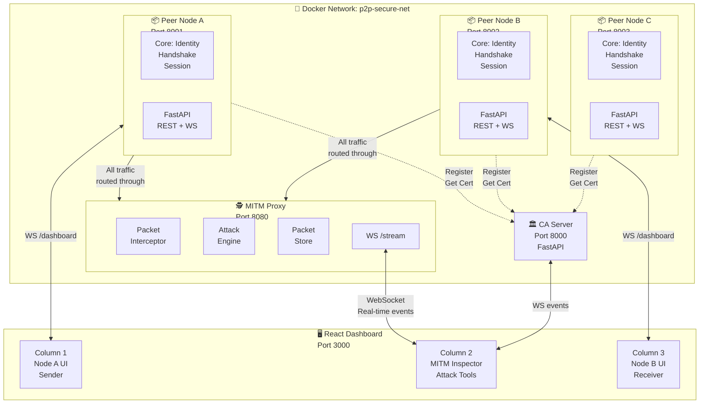
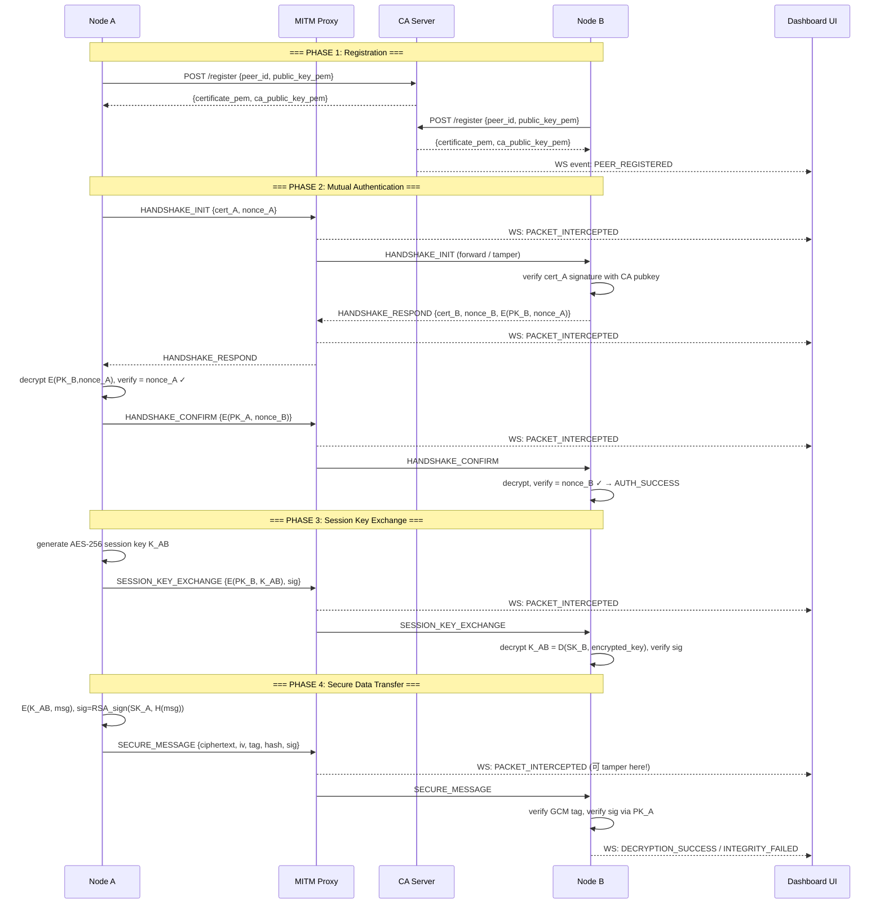

# 🔐 Implementation Plan & Architecture Design
## Hệ thống Chat & Chia sẻ File P2P Bảo mật với CA/KDC

> **Môn học**: Các Hệ Thống Phân Tán | **Tài liệu tham khảo**: Distributed Systems 4th Ed. — van Steen & Tanenbaum (§9.1–9.3)

---

## 1. Tech Stack Đề xuất

* **CA / KDC Server**: Python 3.12 + FastAPI + Uvicorn
  * *Lý do*: Hỗ trợ Asynchronous I/O hiệu năng cao, tích hợp cả REST API và WebSocket trên cùng một tiến trình, hệ sinh thái thư viện `cryptography` đầy đủ và chuẩn hóa.
* **Peer Node (Node A, Node B, Node C)**: Python 3.12 + FastAPI + WebSockets
  * *Lý do*: Cài đặt kiến trúc Servant (vừa là HTTP Client vừa là HTTP Server tiếp nhận kết nối), tái sử dụng mô hình lập trình và module mật mã chung với CA Server.
* **MITM Proxy / Relay Node**: Python 3.12 + Async HTTP Client (`httpx`) + WebSockets
  * *Lý do*: Đóng vai trò Reverse Proxy bất đồng bộ, chặn bắt gói tin (intercept), sửa đổi bit (tamper), phát lại (replay), và đẩy luồng sự kiện tức thời ra Dashboard.
* **Giao diện Giám sát (Frontend Dashboard)**: React + Vite + TailwindCSS + Zustand + Lucide Icons
  * *Lý do*: Gọn nhẹ, khởi động tức thì, tổ chức component linh hoạt, dễ dàng biểu diễn sơ đồ trực quan 3 cột và cập nhật WebSocket theo thời gian thực.
* **Giao thức Giao tiếp & Định dạng Dữ liệu**:
  * *Transport*: HTTP/1.1 (truyền nhận dữ liệu tin nhắn/file) kết hợp WebSocket (phát trực tiếp gói tin và trạng thái mạng).
  * *Data Format*: JSON chuẩn hóa cho tất cả các loại bản tin để dễ đọc, dễ hiển thị trên Packet Inspector.
* **Thư viện Mật mã**: `cryptography` (Python)
  * *Primitives*: RSA-2048 (OAEP padding), AES-256-GCM (khóa phiên & kiểm tra toàn vẹn), SHA-256 (hàm băm an toàn), X.509 (chứng chỉ số công khai).
* **Đóng gói Phân tán**: Docker & Docker Compose
  * *Cơ chế*: Mỗi node chạy trong một Docker container độc lập, kết nối với nhau qua bridge network `p2p-secure-net`.
* **Cơ chế Khám phá Node (Peer Discovery)**:
  * Đăng ký định danh lên CA Server khi khởi động và truy vấn danh sách node qua API `GET /peers`.

---

## 2. Cấu trúc Thư mục (Monorepo)

```
secure-p2p-network/
├── docker-compose.yml              # Orchestrate toàn bộ hệ thống
├── .env.example                    # Biến môi trường mẫu
├── README.md
│
├── ca_server/                      # === CA / KDC Server ===
│   ├── Dockerfile
│   ├── requirements.txt
│   ├── main.py                     # FastAPI entrypoint
│   ├── core/
│   │   ├── crypto.py               # RSA key gen, X.509 cert signing, CRL
│   │   ├── certificate_store.py    # In-memory + JSON persistence cert store
│   │   └── kdc.py                  # (Optional) Kerberos-style ticket logic
│   ├── api/
│   │   ├── routes_cert.py          # POST /register, GET /cert/{peer_id}, GET /crl
│   │   └── routes_ws.py            # WS /events  → broadcast CA events to dashboard
│   └── tests/
│       └── test_crypto.py
│
├── peer_node/                      # === Peer Node (A, B, C…) ===
│   ├── Dockerfile
│   ├── requirements.txt
│   ├── main.py                     # FastAPI entrypoint (runs on PORT env var)
│   ├── core/
│   │   ├── crypto.py               # Reuse/symlink từ ca_server hoặc shared lib
│   │   ├── identity.py             # Key generation, cert request, cert storage
│   │   ├── handshake.py            # Mutual auth protocol (Challenge-Response)
│   │   ├── session.py              # Session key (AES-256-GCM) management
│   │   └── peer_discovery.py       # GET /peers from CA, maintain peer list
│   ├── api/
│   │   ├── routes_peer.py          # POST /handshake/init, /handshake/respond
│   │   ├── routes_message.py       # POST /message, POST /file
│   │   └── routes_ws.py            # WS /dashboard → stream own events
│   ├── config.py                   # NODE_ID, CA_URL, PORT, PROXY_URL
│   └── tests/
│
├── mitm_proxy/                     # === MITM Proxy / Relay Node ===
│   ├── Dockerfile
│   ├── requirements.txt
│   ├── main.py                     # Async TCP/HTTP intercept proxy
│   ├── core/
│   │   ├── interceptor.py          # Capture, queue, optionally modify packets
│   │   ├── attack_engine.py        # Tamper / Replay / Spoof logic
│   │   └── packet_store.py         # Ring buffer of captured packets
│   ├── api/
│   │   ├── routes_control.py       # POST /attack/{tamper|replay|spoof|passthrough}
│   │   └── routes_ws.py            # WS /stream → fan-out packets to Dashboard
│   └── tests/
│
├── frontend_ui/                    # === React Dashboard ===
│   ├── Dockerfile
│   ├── package.json
│   ├── vite.config.ts
│   ├── tailwind.config.ts
│   ├── src/
│   │   ├── main.tsx
│   │   ├── App.tsx                 # 3-column layout
│   │   ├── components/
│   │   │   ├── NodePanel/          # Shared panel component (dùng cho A và B)
│   │   │   │   ├── KeyStatusCard.tsx     # Hiển thị PK, SK fingerprint, Cert info
│   │   │   │   ├── ChatWindow.tsx        # Chat messages + file upload
│   │   │   │   └── DecryptionLog.tsx     # Step-by-step decryption display
│   │   │   ├── MitmPanel/
│   │   │   │   ├── MessageSequenceChart.tsx  # Animated flow diagram (SVG/Canvas)
│   │   │   │   ├── PacketInspector.tsx       # Clickable packet → JSON detail
│   │   │   │   └── AttackToolbar.tsx          # Attack simulation buttons
│   │   │   └── shared/
│   │   │       ├── StatusLight.tsx     # 🟢🔴 indicator
│   │   │       └── JsonViewer.tsx      # Syntax-highlighted JSON tree
│   │   ├── hooks/
│   │   │   ├── useWebSocket.ts         # Generic WS hook
│   │   │   ├── usePacketStream.ts      # Subscribe to MITM proxy WS
│   │   │   └── useNodeState.ts         # Node A/B key & session state
│   │   ├── store/
│   │   │   └── packetStore.ts          # Zustand store for packet history
│   │   └── types/
│   │       └── protocol.ts             # TypeScript interfaces cho JSON schema
│   └── public/
│
└── shared/                         # === Shared utilities (optional) ===
    └── crypto_utils.py             # Common crypto helpers
```

---

## 3. Thiết kế Chi tiết Giao thức & JSON Schema

### 3.1 — Bước 1: Đăng ký & Nhận Certificate (§9.2.4)

**Request: `POST /register` → CA Server**
```json
{
  "type": "REGISTER_REQUEST",
  "peer_id": "node_a",
  "public_key_pem": "-----BEGIN PUBLIC KEY-----\n...",
  "timestamp": "2026-11-03T10:00:00Z"
}
```

**Response: CA Server → Peer**
```json
{
  "type": "REGISTER_RESPONSE",
  "peer_id": "node_a",
  "certificate": {
    "subject": "node_a",
    "issuer": "CA_ROOT",
    "public_key_pem": "-----BEGIN PUBLIC KEY-----\n...",
    "serial_number": "0x1A2B3C",
    "not_before": "2026-11-03T10:00:00Z",
    "not_after":  "2026-12-03T10:00:00Z",
    "signature_alg": "RSA-SHA256"
  },
  "certificate_pem": "-----BEGIN CERTIFICATE-----\n...",
  "ca_public_key_pem": "-----BEGIN PUBLIC KEY-----\n..."
}
```

---

### 3.2 — Bước 2: Mutual Authentication Handshake (§9.3.2)

**Step 2a — Init Handshake: `POST /handshake/init` (Node A → Node B qua Proxy)**
```json
{
  "type": "HANDSHAKE_INIT",
  "from": "node_a",
  "to":   "node_b",
  "certificate_pem": "-----BEGIN CERTIFICATE-----\n...",
  "nonce_A": "base64(random_32_bytes)",
  "timestamp": "2026-11-03T10:01:00Z"
}
```

**Step 2b — Challenge Response: `POST /handshake/respond` (Node B → Node A)**
```json
{
  "type": "HANDSHAKE_RESPOND",
  "from": "node_b",
  "to":   "node_a",
  "certificate_pem": "-----BEGIN CERTIFICATE-----\n...",
  "nonce_B": "base64(random_32_bytes)",
  "encrypted_nonce_A": "base64( RSA-OAEP_encrypt(PK_B, nonce_A) )",
  "timestamp": "2026-11-03T10:01:01Z"
}
```
> Node A kiểm tra: giải mã `encrypted_nonce_A` bằng `SK_A` → phải khớp `nonce_A` gốc.

**Step 2c — Final Confirm: Node A → Node B**
```json
{
  "type": "HANDSHAKE_CONFIRM",
  "from": "node_a",
  "to":   "node_b",
  "encrypted_nonce_B": "base64( RSA-OAEP_encrypt(PK_A, nonce_B) )",
  "status": "AUTH_SUCCESS",
  "timestamp": "2026-11-03T10:01:02Z"
}
```

---

### 3.3 — Bước 3: Session Key Exchange (§9.2.2 & 9.2.4)

**`POST /session/key` (Node A → Node B qua Proxy)**
```json
{
  "type": "SESSION_KEY_EXCHANGE",
  "from": "node_a",
  "to":   "node_b",
  "encrypted_session_key": "base64( RSA-OAEP_encrypt(PK_B, AES-256-key) )",
  "session_id": "uuid-v4",
  "timestamp": "2026-11-03T10:01:03Z",
  "signature": "base64( RSA_sign(SK_A, SHA256(encrypted_session_key + session_id + timestamp)) )"
}
```

---

### 3.4 — Bước 4: Truyền Dữ liệu Bảo mật (§9.2.2 & 9.2.3)

**Tin nhắn: `POST /message`**
```json
{
  "type": "SECURE_MESSAGE",
  "from": "node_a",
  "to":   "node_b",
  "session_id": "uuid-v4",
  "payload": {
    "ciphertext": "base64( AES-256-GCM_encrypt(K_AB, plaintext) )",
    "iv":  "base64(12_random_bytes)",
    "tag": "base64(16_byte_GCM_auth_tag)"
  },
  "integrity": {
    "hash":      "base64( SHA-256(plaintext) )",
    "signature": "base64( RSA_sign(SK_A, SHA-256(plaintext)) )"
  },
  "timestamp": "2026-11-03T10:02:00Z",
  "message_id": "uuid-v4"
}
```

**File: `POST /file`**
```json
{
  "type": "SECURE_FILE",
  "from": "node_a",
  "to":   "node_b",
  "session_id": "uuid-v4",
  "file_meta": {
    "filename": "report.pdf",
    "size_bytes": 204800,
    "mime_type": "application/pdf"
  },
  "payload": {
    "ciphertext_b64": "base64( AES-256-GCM_encrypt(K_AB, file_bytes) )",
    "iv":  "base64(12_bytes)",
    "tag": "base64(16_bytes)"
  },
  "integrity": {
    "hash":      "base64( SHA-256(file_bytes) )",
    "signature": "base64( RSA_sign(SK_A, SHA-256(file_bytes)) )"
  },
  "timestamp": "2026-11-03T10:02:05Z",
  "message_id": "uuid-v4"
}
```

---

### 3.5 — MITM Proxy WebSocket Event Schema

**Mỗi gói tin bị intercept → broadcast ra Dashboard:**
```json
{
  "event": "PACKET_INTERCEPTED",
  "packet_id": "pkt-001",
  "direction": "A → B",
  "packet_type": "SECURE_MESSAGE",
  "raw_json": { "...full packet json..." },
  "intercepted_at": "2026-11-03T10:02:00.123Z",
  "status": "HELD" 
}
```

**Attack Command từ Dashboard → MITM:**
```json
{
  "command": "TAMPER",
  "packet_id": "pkt-001",
  "attack_type": "TAMPER_DATA",
  "modification": {
    "path": "payload.ciphertext",
    "action": "flip_bit",
    "bit_position": 42
  }
}
```

**Attack Result:**
```json
{
  "event": "ATTACK_RESULT",
  "packet_id": "pkt-001",
  "attack_type": "TAMPER_DATA",
  "forwarded_at": "2026-11-03T10:02:01Z",
  "receiver_response": {
    "status": "INTEGRITY_CHECK_FAILED",
    "detail": "GCM auth tag mismatch — ciphertext was modified",
    "error_code": "E_TAG_MISMATCH"
  }
}
```

---

## 4. Kiến trúc Tổng thể (System Architecture)



---

## 5. Luồng Giao thức Chi tiết (Message Sequence Chart)



---

## 6. Lộ trình Triển khai Chi tiết (5 Phases)

### Phase 0: Scaffolding & Khởi tạo Hạ tầng 
* **Mục tiêu**: Dựng khung dự án Monorepo, cấu hình Docker network dùng chung và đảm bảo tất cả container giao tiếp được với nhau.
* **Checklist công việc (Tasks)**:
  - [x] **Khởi tạo cấu trúc dự án**:
    - [x] Tạo cây thư mục Monorepo chuẩn: `ca_server/`, `peer_node/`, `mitm_proxy/`, `frontend_ui/`, `shared/`
    - [x] Tạo file `.env.example` và cấu hình các biến môi trường mẫu (URL, PORT cho từng node)
    - [x] Tạo tài liệu hướng dẫn khởi chạy cơ bản và quản lý môi trường
  - [x] **Container hóa & Mạng Docker**:
    - [x] Viết `Dockerfile` cho `ca_server` (Python 3.12-slim)
    - [x] Viết `Dockerfile` cho `peer_node` (Python 3.12-slim)
    - [x] Viết `Dockerfile` cho `mitm_proxy` (Python 3.12-slim)
    - [x] Viết `Dockerfile` cho `frontend_ui` (Node 20-alpine & Vite)
    - [x] Viết `docker-compose.yml` kết nối các service trong mạng ảo bridge `p2p-secure-net`:
      - `ca_server` (port 8000)
      - `peer_a` (port 8001)
      - `peer_b` (port 8002)
      - `peer_c` (port 8003)
      - `mitm_proxy` (port 8080)
      - `frontend_ui` (port 3000)
  - [x] **Khởi tạo Backend & Health check**:
    - [x] Thiết lập FastAPI app cơ bản trên cả 3 backend service (`ca_server`, `peer_node`, `mitm_proxy`)
    - [x] Cài đặt endpoint `GET /health` trả về trạng thái hoạt động trên tất cả các backend service
    - [x] Cấu hình CORS middleware trên tất cả API để frontend kết nối thuận tiện
  - [x] **Khởi tạo Frontend**:
    - [x] Khởi tạo dự án React + TypeScript với Vite
    - [x] Cấu hình TailwindCSS và Lucide React icons
  - [x] **Kiểm thử tích hợp hạ tầng**:
    - [x] Chạy `docker-compose up --build` kiểm tra toàn bộ container khởi động ổn định
    - [x] Kiểm tra kết nối mạng nội bộ giữa các container trong `p2p-secure-net`
* **Tiêu chí hoàn thành (Deliverable)**:
  - Lệnh `docker-compose up` khởi động thành công và tất cả các container đều trả về trạng thái healthy.

---

### Phase 1: Xây dựng CA Server & Thư viện Mật mã Cốt lõi 
* **Mục tiêu**: Hoàn thiện trung tâm chứng thực khóa công khai (PKI) theo chuẩn X.509 (§9.2.4).
* **Checklist công việc (Tasks)**:
  - [x] **Cài đặt Module Mật mã (`ca_server/core/crypto.py`)**:
    - [x] Hàm sinh cặp khóa RSA 2048-bit (Private Key & Public Key)
    - [x] Hàm tạo CA Root Self-signed Certificate sử dụng RSA-SHA256
    - [x] Hàm tạo và ký chứng chỉ số X.509 Certificate cho Peer node khi đăng ký
    - [x] Hàm xuất và nạp khóa/chứng chỉ dạng PEM string
    - [x] Hàm xác thực tính hợp lệ của Certificate sử dụng CA Root Public Key
  - [x] **Cài đặt Module Lưu trữ Chứng chỉ (`ca_server/core/certificate_store.py`)**:
    - [x] Quản lý bộ nhớ in-memory lưu trữ danh sách Certificate đã cấp
    - [x] Cơ chế đồng bộ và lưu trữ bền vững chứng chỉ xuống file `data/certs.json`
    - [x] Quản lý danh sách thu hồi chứng chỉ (CRL - Certificate Revocation List)
  - [x] **Xây dựng REST API Endpoints (`ca_server/api/routes_cert.py`)**:
    - [x] `POST /register`: Nhận Public Key của Peer, thẩm tra thông tin định danh, cấp phát X.509 Certificate
    - [x] `GET /cert/{peer_id}`: Tra cứu thông tin và PEM của chứng chỉ số theo `peer_id`
    - [x] `GET /ca-cert`: Tải chứng chỉ công khai của CA để các node dùng xác thực chuỗi tin cậy
    - [x] `GET /peers`: Trả về danh sách tất cả các active peer đã đăng ký (phục vụ Peer Discovery)
    - [x] `POST /revoke/{peer_id}`: Thu hồi chứng chỉ khi node bị nghi ngờ lộ khóa bí mật
    - [x] `GET /crl`: Trả về danh sách chứng chỉ đã bị thu hồi
  - [x] **Kênh WebSocket Sự kiện (`ca_server/api/routes_ws.py`)**:
    - [x] Thiết lập WebSocket endpoint `WS /events`
    - [x] Phát broadcast event `PEER_REGISTERED` khi có node mới đăng ký
    - [x] Phát broadcast event `CERT_REVOKED` khi có chứng chỉ bị thu hồi
  - [x] **Viết Unit Tests & Xác thực (`ca_server/tests/test_crypto.py`)**:
    - [x] Test quy trình sinh khóa RSA và tạo Root CA
    - [x] Test ký chứng chỉ số cho peer và kiểm tra tính hợp lệ bằng CA Public Key
    - [x] Test phát hiện chứng chỉ bị giả mạo chữ ký hoặc chứng chỉ đã bị thu hồi
* **Tiêu chí hoàn thành (Deliverable)**:
  - Unit test cho quy trình sinh khóa, ký chứng chỉ, và xác minh chuỗi tin cậy (Certificate Chain) chạy đạt 100%.

---

### Phase 2: Phát triển Peer Node — Định danh, Bắt tay & Khóa phiên 
* **Mục tiêu**: Cài đặt mô hình Servant cho các Peer Node, thực thi đầy đủ giao thức xác thực lẫn nhau (§9.3.2) và quản lý khóa phiên AES-256 (§9.2.2).
* **Checklist công việc (Tasks)**:
  - [x] **Quản lý Định danh & Đăng ký CA (`peer_node/core/identity.py`)**:
    - [x] Khi khởi động lần đầu: tự sinh cặp khóa RSA 2048-bit cục bộ
    - [x] Tự động gửi `POST /register` lên CA Server để nhận X.509 Certificate
    - [x] Tự động tải CA Root Certificate từ CA Server để lưu vào trust store cục bộ
  - [x] **Cơ chế Khám phá Node (`peer_node/core/peer_discovery.py`)**:
    - [x] Gọi API `GET /peers` lên CA định kỳ hoặc theo yêu cầu
    - [x] Duy trì danh bạ active peers trong bộ nhớ (ID, endpoint, trạng thái)
  - [x] **Giao thức Bắt tay Xác thực Lẫn nhau (`peer_node/core/handshake.py`)**:
    - [x] Cài đặt bước 2a (Init): Tạo ngẫu nhiên `nonce_A` (32 bytes), đóng gói `HANDSHAKE_INIT` kèm Certificate
    - [x] Cài đặt bước 2b (Respond): Xác minh Certificate bên gửi qua CA PubKey, sinh `nonce_B`, mã hóa `nonce_A` bằng PK của bên gửi, gửi phản hồi `HANDSHAKE_RESPOND`
    - [x] Cài đặt bước 2c (Confirm): Giải mã kiểm tra `nonce_A` trùng khớp gốc, mã hóa `nonce_B` gửi phản hồi `HANDSHAKE_CONFIRM`
    - [x] Cơ chế chống Replay Attack: Quản lý cache `_used_nonces` & kiểm tra timestamp để từ chối ngay lập tức nonce tái sử dụng
  - [x] **Quản lý Khóa phiên & Xử lý Mật mã Dữ liệu (`peer_node/core/session.py`)**:
    - [x] Sinh khóa đối xứng AES-256 ngẫu nhiên (`K_AB`) cho mỗi phiên giao tiếp
    - [x] Đóng gói và mã hóa khóa phiên bằng RSA-OAEP với Public Key của node nhận: `E(PK_B, K_AB)`
    - [x] Ký số RSA-PSS lên khối thông tin khóa phiên: `sig = SK_A(H(payload))` để chống chối bỏ
    - [x] Bên nhận giải mã lấy `K_AB` bằng Private Key `SK_B` và xác thực chữ ký bằng `PK_A`
    - [x] Cài đặt mã hóa dữ liệu tin nhắn/file: AES-256-GCM sinh ciphertext, IV 12 bytes, Auth Tag 16 bytes
    - [x] Cài đặt băm dữ liệu gốc SHA-256 và ký số RSA-PSS: `sig = SK_A(SHA256(data))`
    - [x] Cài đặt quy trình thẩm tra 3 lớp ở bên nhận:
      - [x] Lớp 1: Chống phát lại (kiểm tra timestamp và message_id đã xử lý)
      - [x] Lớp 2: Kiểm tra toàn vẹn tầng đối xứng (thẩm tra GCM Auth Tag)
      - [x] Lớp 3: Kiểm tra xác thực nguồn gốc & chống chối bỏ (đối chiếu RSA Signature với SHA-256)
  - [x] **Hệ thống API REST & WebSocket của Peer (`peer_node/api/`)**:
    - [x] Endpoint bắt tay: `POST /handshake/init`, `POST /handshake/respond`, `POST /handshake/confirm`
    - [x] Endpoint nhận khóa phiên: `POST /session/key`
    - [x] Endpoint nhận dữ liệu bảo mật: `POST /message`, `POST /file`
    - [x] Endpoint điều khiển chủ động: `POST /connect` (kết nối peer), `POST /send/message` (gửi tin nhắn qua proxy)
    - [x] Kênh WebSocket `WS /dashboard`: Đẩy trạng thái khóa, session, tiến trình bắt tay và log giải mã thời gian thực
  - [x] **Kiểm thử tích hợp luồng giao tiếp P2P**:
    - [x] Viết kịch bản test CLI/curl giả lập Node A kết nối Node B, trao đổi khóa và truyền tin mã hóa thành công
* **Tiêu chí hoàn thành (Deliverable)**:
  - Node A và Node B tự động hoàn thành chu trình bắt tay, trao đổi khóa phiên và mã hóa - giải mã dữ liệu thành công qua giao diện dòng lệnh (CLI/curl).

---

### Phase 3: Xây dựng MITM Proxy & Công cụ Tấn công Gói tin 
* **Mục tiêu**: Đóng vai trò môi trường mạng truyền dẫn trung gian, cho phép Dashboard bắt giữ, kiểm tra gói tin và can thiệp thực hiện các kịch bản tấn công (§9.1.1).
* **Checklist công việc (Tasks)**:
  - [ ] **Lớp Chặn bắt Gói tin (`mitm_proxy/core/interceptor.py`)**:
    - [ ] Lắng nghe HTTP request trung gian giữa các peer dựa trên header định tuyến `X-Target-URL`
    - [ ] Trích xuất metadata gói tin: `packet_id`, hướng truyền (`direction`), loại gói tin (`type`), timestamp
    - [ ] Cài đặt 2 chế độ chuyển tiếp:
      - [ ] Chế độ Passthrough: Gói tin được phân tích và forward ngay lập tức đến đích
      - [ ] Chế độ Hold (Intercept): Gói tin bị giữ lại hàng đợi, chờ lệnh từ Dashboard UI
  - [ ] **Kho lưu trữ Gói tin (`mitm_proxy/core/packet_store.py`)**:
    - [ ] Cấu trúc Ring Buffer lưu trữ 500 gói tin gần nhất
    - [ ] Hỗ trợ tra cứu nhanh gói tin theo `packet_id` và lọc theo trạng thái (`HELD`, `FORWARDED`, `TAMPERED`)
  - [ ] **Engine Mô phỏng 3 Kịch bản Tấn công (`mitm_proxy/core/attack_engine.py`)**:
    - [ ] **Kịch bản 1 — Sửa đổi Dữ liệu (Tamper Data)**:
      - [ ] Lật đảo 1 hoặc nhiều bit ngẫu nhiên trong trường `ciphertext` hoặc `iv`
      - [ ] Chuyển tiếp gói đã sửa đổi tới node đích
      - [ ] Kiểm tra phản hồi lỗi từ node nhận: `INTEGRITY_CHECK_FAILED` (GCM auth tag mismatch)
    - [ ] **Kịch bản 2 — Phát lại Gói tin (Replay Attack)**:
      - [ ] Chọn gói tin cũ hợp lệ (`HANDSHAKE_INIT` hoặc `SECURE_MESSAGE`) từ packet store và gửi lại lần 2
      - [ ] Kiểm tra phản hồi lỗi từ node nhận: `REPLAY_ATTACK_DETECTED` (trùng nonce hoặc message_id)
    - [ ] **Kịch bản 3 — Giả mạo Danh tính (Spoof Identity)**:
      - [ ] Tự sinh chứng chỉ giả mạo (Self-signed không được CA ký hoặc do CA lạ ký)
      - [ ] Thay thế Certificate trong gói `HANDSHAKE_INIT` bằng cert giả mạo
      - [ ] Kiểm tra phản hồi lỗi từ node nhận: `CERTIFICATE_VERIFICATION_FAILED`
  - [ ] **API Điều khiển & Kênh WebSocket Stream (`mitm_proxy/api/`)**:
    - [ ] `POST /attack/mode`: Bật/tắt chế độ Hold vs Passthrough
    - [ ] `POST /attack/tamper`: Chỉ đạo proxy sửa bit trên gói tin cụ thể
    - [ ] `POST /attack/replay`: Chỉ đạo proxy phát lại một gói tin trong lịch sử
    - [ ] `POST /attack/spoof`: Chỉ đạo proxy tráo đổi chứng chỉ số
    - [ ] `POST /attack/release`: Cho phép gói tin đang bị giữ tiếp tục được gửi đi
    - [ ] `WS /ws/stream`: Phát broadcast tức thời các sự kiện `PACKET_INTERCEPTED`, `ATTACK_RESULT` ra Dashboard UI
  - [ ] **Kiểm thử mô phỏng tấn công**:
    - [ ] Kiểm thử lần lượt 3 kịch bản tấn công qua API và xác thực phản hồi từ chối từ node nhận
* **Tiêu chí hoàn thành (Deliverable)**:
  - Có thể thử nghiệm can thiệp lật bit hoặc phát lại gói tin qua API và ghi nhận được phản hồi lỗi chính xác từ Node nhận.

---

### Phase 4: Phát triển Giao diện Trực quan 3 Cột (Frontend Dashboard) 
* **Mục tiêu**: Xây dựng giao diện web React trực quan, phản hồi tức thời theo thời gian thực, minh họa sinh động từng nguyên lý bảo mật.
* **Checklist công việc (Tasks)**:
  - [ ] **Khởi tạo Nền tảng Frontend & Quản lý Trạng thái**:
    - [ ] Thiết lập bố cục 3 cột responsive (`App.tsx`): Cột 1 (Node A), Cột 2 (MITM), Cột 3 (Node B)
    - [ ] Xây dựng Zustand store (`packetStore.ts`, `nodeStateStore.ts`) quản lý gói tin, kết nối và attack state
    - [ ] Xây dựng custom hooks WebSocket:
      - [ ] `useWebSocket.ts`: Hook generic quản lý kết nối và tự động reconnect
      - [ ] `usePacketStream.ts`: Kết nối stream gói tin từ MITM Proxy (`/ws/stream`)
      - [ ] `useNodeState.ts`: Kết nối stream trạng thái từ Node A, Node B và CA
  - [ ] **Phát triển Cột 1 — Bảng Điều khiển Node A (Sender)**:
    - [ ] `KeyStatusCard`: Hiển thị ID, vân tay Public Key, trạng thái X.509 Certificate do CA cấp, trạng thái khóa AES
    - [ ] `PeerSelector & Connect`: Lấy danh sách node từ CA, nút bấm "Bắt tay & Xác thực"
    - [ ] `ChatWindow`: Ô nhập tin nhắn văn bản, nút tải file đính kèm, nút bấm "Mã hóa & Gửi"
  - [ ] **Phát triển Cột 2 — Bảng Phân tích MITM Proxy & Tấn công (Network Inspector)**:
    - [ ] `MessageSequenceChart`: Vẽ trực quan luồng gói tin chuyển động giữa Node A ➔ Proxy ➔ Node B ➔ CA
    - [ ] `PacketList`: Danh sách gói tin bắt được theo thời gian thực (hiển thị tag gói, chiều gửi, trạng thái HELD/FORWARDED)
    - [ ] `PacketInspector`: Trình hiển thị cấu trúc JSON chi tiết với cú pháp màu mè, giải thích ý nghĩa từng trường mật mã (`nonce`, `ciphertext`, `tag`, `signature`)
    - [ ] `AttackToolbar`:
      - [ ] Công tắc chuyển đổi chế độ Passthrough ↔ Intercept/Hold
      - [ ] Bộ nút tấn công cho gói tin đang bị giữ: "Tamper Data", "Replay", "Spoof Identity", và nút "Cho qua (Release)"
  - [ ] **Phát triển Cột 3 — Bảng Điều khiển Node B (Receiver)**:
    - [ ] `KeyStatusCard`: Hiển thị định danh, Public Key fingerprint và chứng chỉ của Node B
    - [ ] `SecurityStatusLight`: Đèn trạng thái lớn (🟢 Xanh: Toàn vẹn, xác thực thành công / 🔴 Đỏ: Cảnh báo phát hiện tấn công)
    - [ ] `DecryptionLog`: Hộp hiển thị quy trình thẩm tra 3 bước chi tiết:
      - Bước 1: Kiểm tra chống phát lại (Nonce / Timestamp)
      - Bước 2: Kiểm tra toàn vẹn đối xứng (GCM Auth Tag)
      - Bước 3: Xác minh tính xác thực nguồn gốc (Chữ ký số RSA-PSS)
    - [ ] `ReceivedContent`: Hiển thị nội dung tin nhắn plaintext và file tải về sau khi giải mã thành công
  - [ ] **Kiểm thử Tích hợp & Hoàn thiện Trải nghiệm (E2E Test)**:
    - [ ] Kiểm tra tương tác mượt mà giữa các WebSocket stream không bị nghẽn
    - [ ] Thử nghiệm luồng gửi tin nhắn chuẩn: xem gói tin bay qua cột 2 và giải mã tại cột 3
    - [ ] Thử nghiệm 3 nút tấn công: kiểm tra Cột 3 bật đèn đỏ cảnh báo chính xác mã lỗi
* **Tiêu chí hoàn thành (Deliverable)**:
  - Thao tác trên giao diện trực quan mượt mà, bấm nút gửi tin nhắn ở Cột 1 thấy gói tin bay qua Cột 2 và giải mã ở Cột 3. Khi bấm các nút tấn công, Cột 3 lập tức bật cảnh báo đỏ với lý do chính xác.

**UI State Machine cho Attack:**
```
[IDLE] → (click Intercept) → [INTERCEPT_MODE]
[INTERCEPT_MODE] → (packet arrives) → [PACKET_HELD]
[PACKET_HELD] → (click Tamper/Replay/Spoof) → [ATTACK_SENT]
[ATTACK_SENT] → (response from B) → [RESULT_SHOWN] → [IDLE]
```

---

## 7. Đối chiếu Lý thuyết Giáo trình với Cài đặt Thực tế (§9.1–9.3)

* **Hiểm họa Bảo mật (Security Threats — §9.1.1)**:
  * *Lý thuyết*: Phân loại 3 mối đe dọa gồm Nghe lén (Interception), Sửa đổi trái phép (Modification), và Giả mạo/Chế tạo (Fabrication).
  * *Cài đặt*: Được kiểm chứng trực quan qua MITM Proxy với 3 nút tấn công: Sửa bit ciphertext (Tamper), Phát lại gói tin cũ (Replay), và Thay thế chứng chỉ số giả mạo (Spoof).
* **Mật mã Khóa Đối xứng (Symmetric Cryptosystems — §9.2.1)**:
  * *Lý thuyết*: Sử dụng chung một khóa $K_{A,B}$ để mã hóa và giải mã với tốc độ xử lý nhanh.
  * *Cài đặt*: Triển khai thuật toán chuẩn AES-256-GCM để mã hóa tin nhắn và file, tự động sinh khóa phiên mới cho mỗi lượt kết nối.
* **Mật mã Khóa Bất đối xứng (Asymmetric Cryptosystems — §9.2.2)**:
  * *Lý thuyết*: Sử dụng cặp khóa công khai ($PK$) và khóa bí mật ($SK$).
  * *Cài đặt*: Triển khai cặp khóa RSA 2048-bit; dùng $PK_B$ để bọc khóa phiên ($K_{A,B}$) qua RSA-OAEP khi trao đổi khóa.
* **Hàm Băm & Chữ ký Điện tử (Digital Signatures & Hashing — §9.2.3)**:
  * *Lý thuyết*: Kết hợp hàm băm một chiều $H(m)$ với mã hóa bằng khóa riêng của người gửi $SK_A$ để đảm bảo tính toàn vẹn (Integrity) và chống chối bỏ (Non-repudiation).
  * *Cài đặt*: Băm nội dung bằng SHA-256 và ký số RSA-PSS; bên nhận giải mã chữ ký bằng $PK_A$ và đối chiếu với giá trị băm tính lại.
* **Quản lý & Phân phối Khóa (Key Management & Certificates — §9.2.4)**:
  * *Lý thuyết*: Sử dụng nhà cung cấp chứng chỉ số (Certification Authority - CA) để ký số chứng thực mối liên kết giữa định danh và Public Key.
  * *Cài đặt*: CA Server cấp phát Digital Certificate theo chuẩn X.509 có chữ ký của CA Root; các peer kiểm tra chuỗi tin cậy trước khi chấp nhận khóa.
* **Giao thức Xác thực Lẫn nhau (Mutual Authentication — §9.3.2)**:
  * *Lý thuyết*: Giao thức Challenge-Response đa chiều sử dụng số ngẫu nhiên chỉ dùng một lần (Nonce) để chứng minh quyền sở hữu khóa bí mật và chống tấn công phát lại.
  * *Cài đặt*: Bắt tay 3 bước với cặp Nonce 32-byte ngẫu nhiên $R_A, R_B$ được mã hóa và xác minh chéo giữa hai Peer.

---

## 8. Docker Compose Blueprint

```yaml
# docker-compose.yml (preview)
version: "3.9"
networks:
  p2p-secure-net:
    driver: bridge

services:
  ca_server:
    build: ./ca_server
    ports: ["8000:8000"]
    networks: [p2p-secure-net]
    environment:
      - NODE_ID=CA_ROOT
      - PORT=8000
    volumes:
      - ca_data:/app/data   # persist certificates

  peer_a:
    build: ./peer_node
    ports: ["8001:8001"]
    networks: [p2p-secure-net]
    environment:
      - NODE_ID=node_a
      - PORT=8001
      - CA_URL=http://ca_server:8000
      - PROXY_URL=http://mitm_proxy:8080
    depends_on: [ca_server, mitm_proxy]

  peer_b:
    build: ./peer_node
    ports: ["8002:8002"]
    networks: [p2p-secure-net]
    environment:
      - NODE_ID=node_b
      - PORT=8002
      - CA_URL=http://ca_server:8000
      - PROXY_URL=http://mitm_proxy:8080
    depends_on: [ca_server, mitm_proxy]

  peer_c:
    build: ./peer_node
    ports: ["8003:8003"]
    networks: [p2p-secure-net]
    environment:
      - NODE_ID=node_c
      - PORT=8003
      - CA_URL=http://ca_server:8000
      - PROXY_URL=http://mitm_proxy:8080
    depends_on: [ca_server, mitm_proxy]

  mitm_proxy:
    build: ./mitm_proxy
    ports: ["8080:8080"]
    networks: [p2p-secure-net]
    environment:
      - PORT=8080
      - CA_URL=http://ca_server:8000

  frontend_ui:
    build: ./frontend_ui
    ports: ["3000:3000"]
    networks: [p2p-secure-net]
    environment:
      - VITE_MITM_WS=ws://localhost:8080/stream
      - VITE_NODE_A_WS=ws://localhost:8001/dashboard
      - VITE_NODE_B_WS=ws://localhost:8002/dashboard
      - VITE_CA_WS=ws://localhost:8000/events
      - VITE_MITM_API=http://localhost:8080

volumes:
  ca_data:
```

---

## 9. Kế hoạch Phân bổ Thời gian & Thứ tự Thực hiện

* **Thứ tự thực hiện (Pipeline)**:
  * Phase 0 (Hạ tầng & Scaffolding) ➔ Phase 1 (CA Server & PKI) ➔ Phase 2 (Peer Node & Handshake) ➔ Phase 3 (MITM Proxy & Tấn công) ➔ Phase 4 (Frontend UI) ➔ Hoàn thiện Demo.

* **Phân bổ chi tiết từng giai đoạn**:
  * **Phase 0 — Scaffolding & Môi trường**: Ước tính ~2 giờ (Mức độ ưu tiên: Bắt đầu ngay).
  * **Phase 1 — CA Server & Crypto Core**: Ước tính ~4 giờ (Mức độ ưu tiên: Trọng yếu - Critical Path).
  * **Phase 2 — Peer Identity, Handshake & Session**: Ước tính ~6 giờ (Mức độ ưu tiên: Trọng yếu - Critical Path).
  * **Phase 3 — MITM Proxy & Mô phỏng Tấn công**: Ước tính ~4 giờ (Mức độ ưu tiên: Quan trọng).
  * **Phase 4 — Frontend Dashboard & Trực quan hóa**: Ước tính ~6 giờ (Mức độ ưu tiên: Quan trọng).
  * **Tổng thời lượng ước tính**: ~22 giờ làm việc tập trung.

---

## 10. Checklist Demo cuối kỳ

- [ ] `docker-compose up` → tất cả services online
- [ ] Node A tự đăng ký → nhận Certificate từ CA
- [ ] Node A và B thực hiện Mutual Authentication thành công (3-step)
- [ ] Session key AES-256 được trao đổi an toàn
- [ ] Tin nhắn plaintext được mã hóa, truyền, giải mã thành công
- [ ] Dashboard hiển thị toàn bộ packet flow với MSC diagram
- [ ] **Attack Demo 1**: Tamper → Node B báo `INTEGRITY_CHECK_FAILED`
- [ ] **Attack Demo 2**: Replay → Node B báo `NONCE_ALREADY_USED`
- [ ] **Attack Demo 3**: Spoof → Node B báo `CERTIFICATE_SIGNATURE_INVALID`
- [ ] Status light đổi 🔴 khi attack được phát hiện
- [ ] Packet Inspector hiển thị full JSON với highlight

---

> **⚠️ Lưu ý quan trọng**: Toàn bộ crypto operations sử dụng thư viện chuẩn (`cryptography` cho Python), **không tự viết thuật toán crypto**. Mục tiêu là cài đặt tường minh *giao thức* (protocol logic) — cách các primitive được kết hợp với nhau theo đúng §9.1–9.3.
